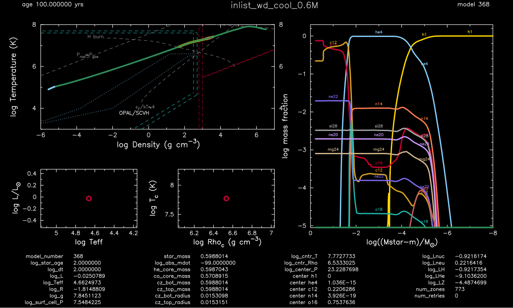

.. _wd_cool_wdm_av:

**************
wd_cool_wdm_av
**************

.. tags:: star, white-dwarf, carbon-oxygen-white-dwarf, element-diffusion, white-dwarf-cooling, eos

This test case is a copy of :ref:`wd_cool_0.6M` with the ``WDM_AV`` (warm dense matter,
additive-volume) component of the ``eosDT`` cascade switched on. It is the first
stellar-evolution exercise of ``WDM_AV`` (WP7). It loads the same ``co_wd_settled.mod``,
keeps the base Skye / Ogata-solid-mixing / phase-separation / diffusion settings, and is
meant to stop at ``log_center_temp = 6``.

The ``&eos`` additions are::

   use_WDM_AV = .true.
   WDM_AV_table_set = 'skye'
   WDM_AV_mixing_rule = 'pressure'
   logRho_max_for_all_WDM_AV = 3.7d0
   logRho_max_for_any_WDM_AV = 4.2d0
   Gamma_max_for_all_WDM_AV = 50d0
   Gamma_max_for_any_WDM_AV = 70d0

The right density edge is placed inside Skye's validity boundary so the hand-over into
Skye lies where Skye is valid, and the coupling-parameter ramp (Decision D23) hands the
fluid-to-crystal regime to Skye before the melting line.

**Measured result (2026-10-29, WP7).** With the low-temperature box edge at its default,
``WDM_AV`` becomes active across the cold, low-density H/He envelope where the
Skye-derived tables are invalid; there the component declines (returns ``ierr`` ->
``skip``), which is a hard switch in ``S``, ``P``, ``E`` with no ramp. The implicit solver
cannot converge through it and the run stalls at ``log_center_temp`` ~ 6.49
(``min_timestep_limit``). Raising the low-temperature box edge so the box stays inside the
tables' coverage removes the declines and the run reaches ``log_center_temp = 6`` with
baseline-like steps and retries; those lines are included commented in
``inlist_wd_cool_wdm_av``. See ``claude_tex_notes/test_reports/wd_test_suite_report`` for
the full comparison, figures, and the Gamma-ramp verification.

The starting model (identical to :ref:`wd_cool_0.6M`):

Last-Updated: 29Oct2026 by the WP7 agent (Claude Opus 4.8).
